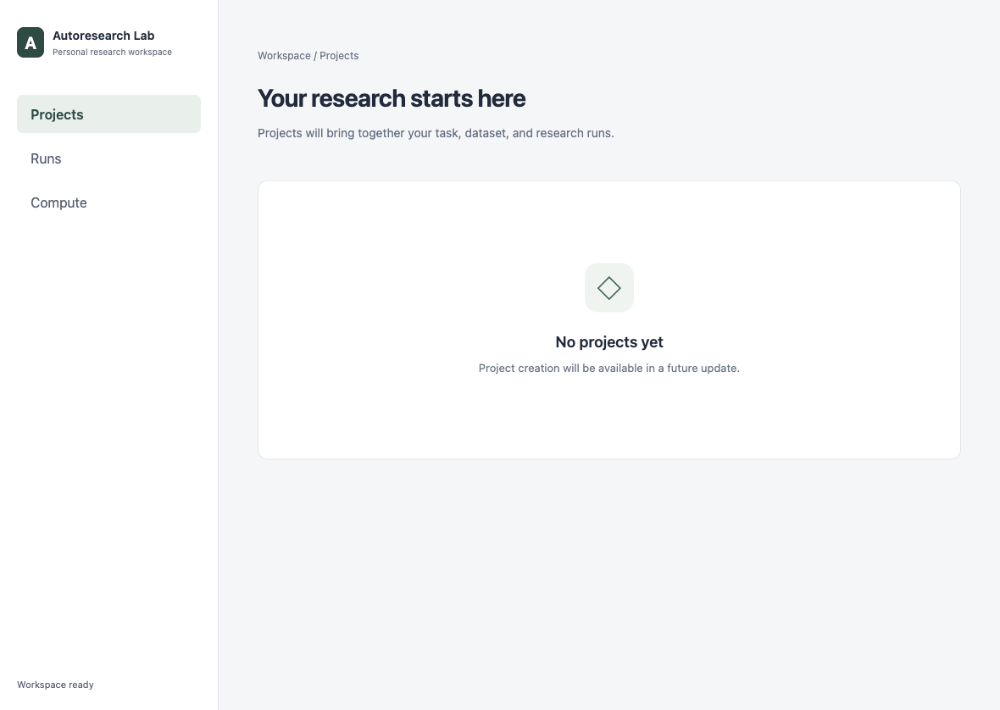
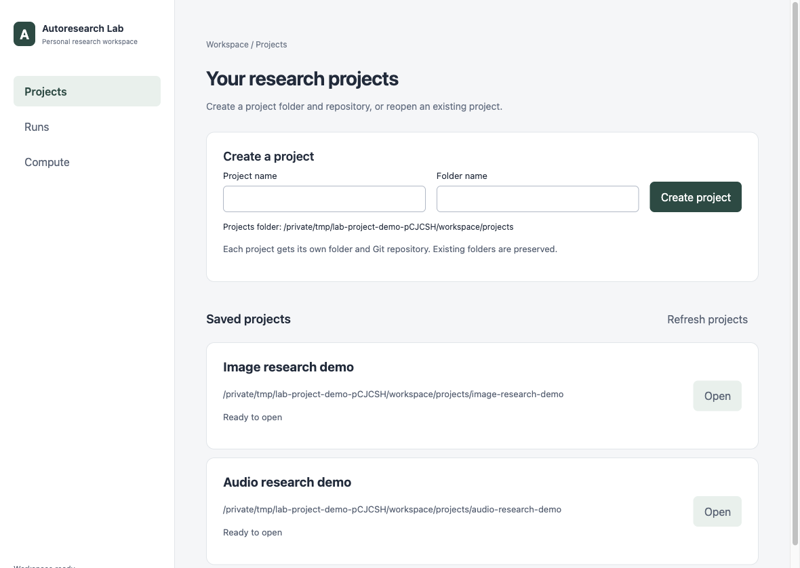
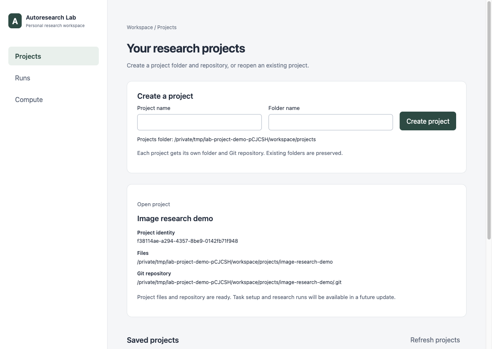

# Issue 19: before and after UI evidence

These are genuine application screenshots for [draft PR #105](https://github.com/igrgin/autoresearch-lab/pull/105),
captured from unmodified macOS arm64 CI packages with Electron/Playwright.
No source checkout was switched, reset or created. Only this issue worktree's
ignored `out/` artifact area and this new evidence directory were written.

## Provenance

- **Before:** exact PR base `acfdada4d42d06f556dc0b96e6d3e282eadf85ac`, from the
  successful [main CI run 43741488909](https://github.com/igrgin/autoresearch-lab/actions/runs/43741488909),
  artifact `autoresearch-lab-macos-arm64` (ID `14172940568`). GitHub's run and
  artifact metadata both identify that exact base commit. The original artifact
  also contains a passing smoke result and the original empty Projects screenshot.
- **After:** implementation head `28f912fe3f9fbc7b1176f86699ba24aea7af25f8`, from
  successful [PR CI run 43744923347](https://github.com/igrgin/autoresearch-lab/actions/runs/43744923347),
  the same artifact name (ID `14173458475`). These evidence additions change no
  product source or behavior.
- Both downloaded ZIPs were extracted into ignored artifact directories inside
  this worktree; their packaged executables were launched directly. No rebuilding
  or modification of either application's HTML, styles, JavaScript or image
  content was used to produce the comparison.
- All PNGs have the same **1180 × 838** renderer viewport at CSS scale. The native
  window size is identical for each capture; the open-project detail is a
  scrolled view. The OS limited the initially requested content height to 838.
- Profiles are fresh temporary directories with only synthetic projects
  **Image research demo** and **Audio research demo**. They contain no provider
  connections, credentials, datasets, personal project names or private paths.
  Visible UUIDs and `/private/tmp/lab-project-demo-*` paths belong to these
  disposable profiles. The profiles are removed after capture.

[provenance.json](./provenance.json) records package/ASAR hashes, artifact IDs and
source commits. [capture-results.json](./capture-results.json) records PNG hashes,
dimensions and the empty renderer error list.

## Before

The base application displays an empty Projects view and says creation will be
available in a future update.



## After: create and list projects

The changed workspace provides creation controls and lists two independent saved
projects with Open actions. Both were created through the UI; this screenshot
was taken after a full application restart.



## After: reopen a project

Opening the saved project displays the same project identity, files folder and
Git repository after restart. The capture driver asserts the reopened record
matches the one returned on creation.



## Capture and checks

[The capture driver](./capture.mjs) accepts the before and after packaged
executable paths. Run it from the repository root with the documented Node
version, after extracting the two authenticated CI artifact ZIPs:

```sh
node docs/egm/implementation/19-ui-evidence/capture.mjs \
  'out/pr-105-baseline-app/Autoresearch Lab.app/Contents/MacOS/Autoresearch Lab' \
  'out/pr-105-head-app/Autoresearch Lab.app/Contents/MacOS/Autoresearch Lab'
```

The final capture run passes creation of both projects, persisted listing after
restart, unchanged identity on reopen, equal screenshot dimensions and zero
renderer page/console errors. Syntax checking and ESLint for the driver,
PNG signature/hash checks, documentation links and `git diff --check` pass.
All three final PNGs were visually inspected for readability and absence of
credentials/private data. Existing implementation validation and limitations
remain recorded in [the original evidence](../19-create-reopen-projects.md).
