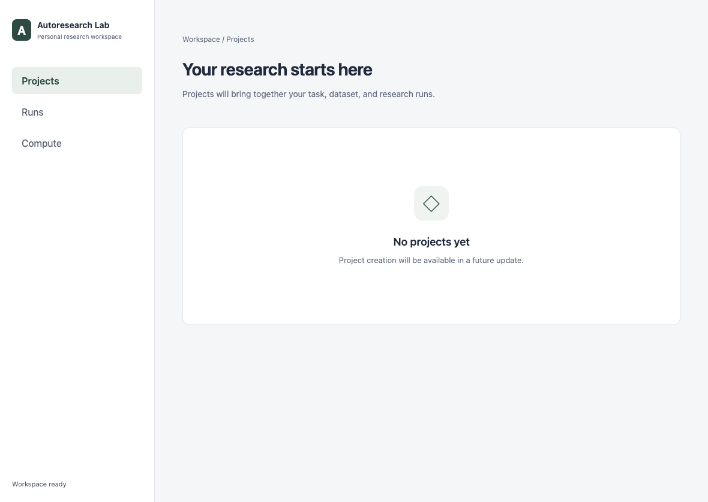
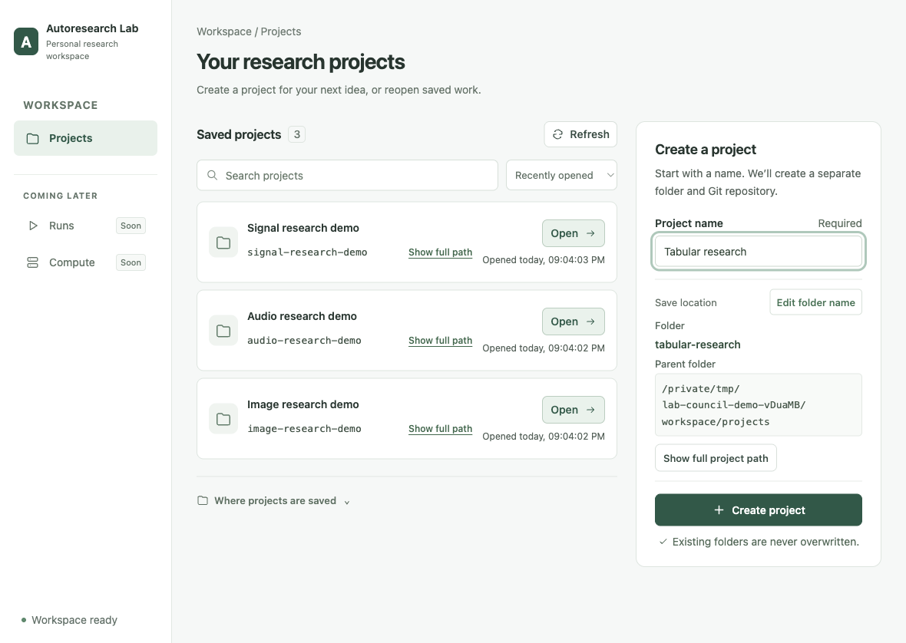
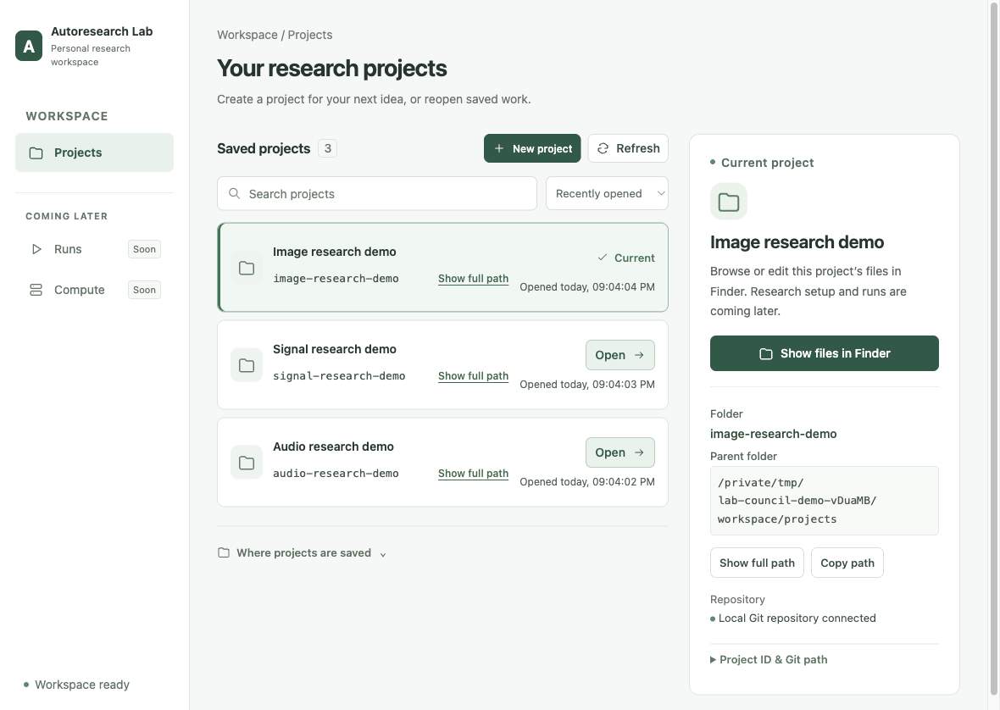

# Issue 19: final before/after UI

The UI loop stopped at the user's ten-round cap. The 9.5/10 unanimity goal was not reached. [All scores and remaining findings](../../../council-ui/README.md) remain available.

## Before

Exact PR base `acfdada4d42d06f556dc0b96e6d3e282eadf85ac`, from its verified successful CI package. The original screenshot and provenance remain unchanged.

## After: creation and saved projects

Final reviewed product source `3e40fb818f0fdbe696658005729055038be8e8e6`, captured from its locally built macOS arm64 package. Three synthetic projects were created through the real UI and persisted across a full restart. A fourth draft name demonstrates the generated destination preview.

## After: reopened project

The current project remains visible beside the saved list, with inspectable paths and validated Finder/clipboard actions. The same project identity and repository binding were confirmed through the catalog after restart.

Both after images exactly match the PNGs submitted to the final council in [round 10](../../../council-ui/round-10/). Before and After use the same 1180×838 viewport and are unedited native Electron captures. No credentials, personal project data or private user paths are present. Temporary paths and identities belong to disposable synthetic profiles. [Original base-package provenance](../provenance.json) and [final capture hashes](../../../council-ui/round-10/capture-results.json) supply traceability.
