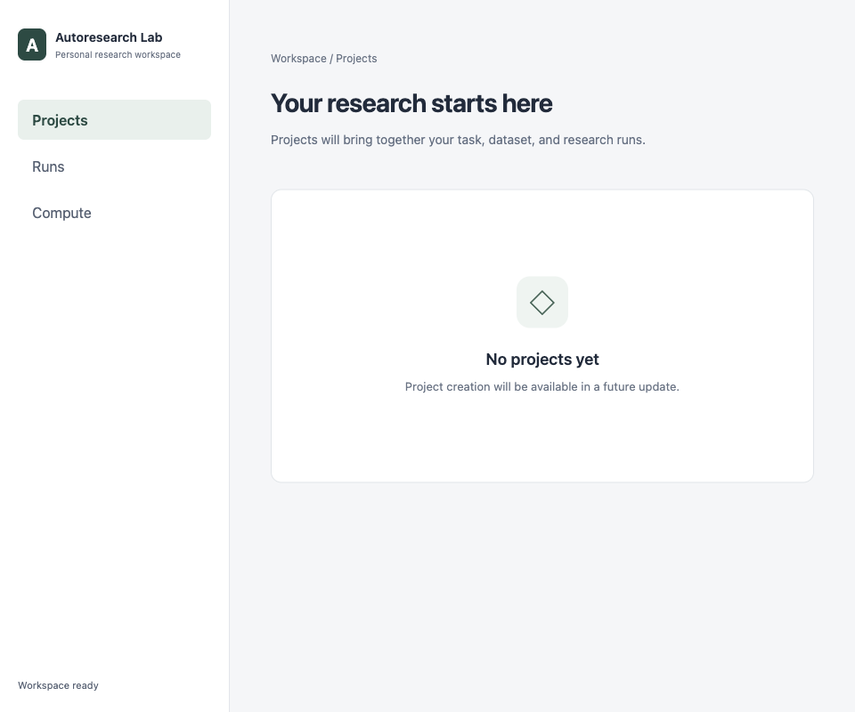
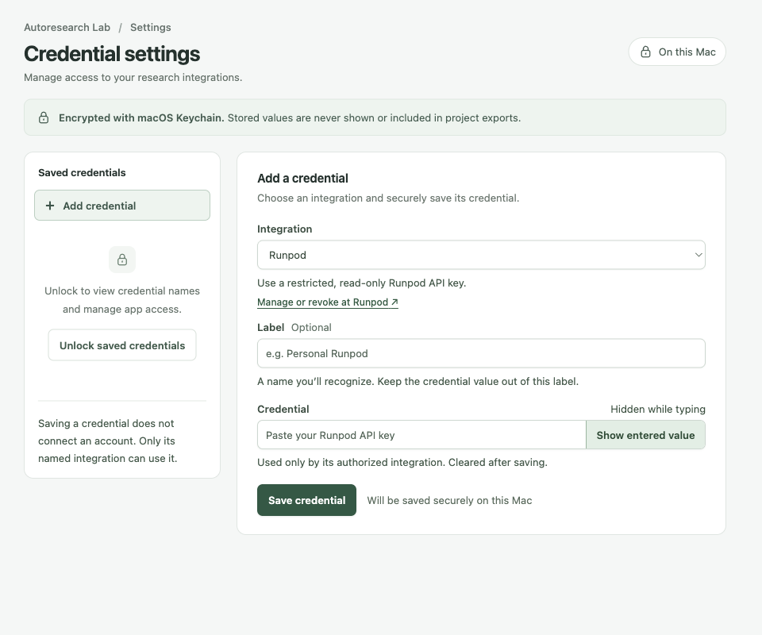
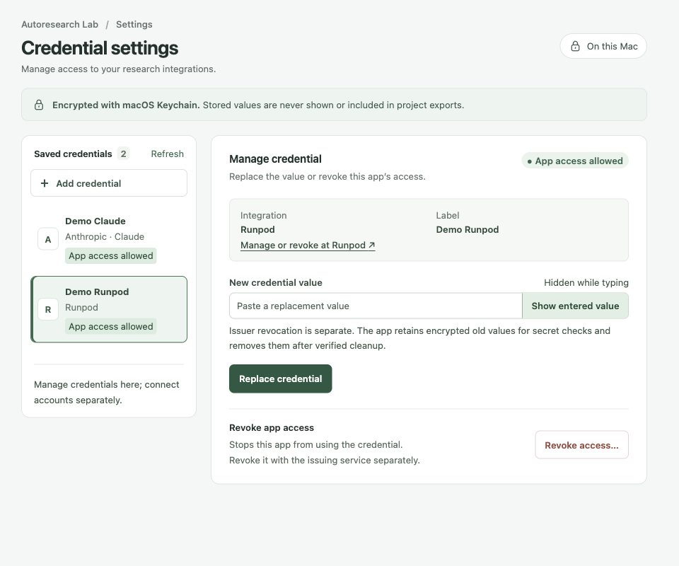

# Issue 21 — UI council and final evidence

Stopped after **10 rounds** at the user's explicit limit. The requested threshold
was **9.5 or higher from every member on both requirements**. It was **not met**.
No round 11 was started and no further design changes were made after round 10.

| Final member | UI functionality | UI appearance |
| --- | --- | --- |
| GPT 6.1 Sol | 9.4 | 9.4 |
| GPT 6 Astra | 9.3 | 9.5 |
| GPT 6.1 Terra | 9.1 | 9.2 |

These are screenshot-only UI judgments, not backend/security qualifications.
All [30 verbatim reviews](./reviews.json), [numeric scores](./scores.json), and
[round-by-round table](./score-table.md) remain available.

## Method

Every round used three new Codex delegates at high reasoning effort, one each
of `gpt-6.1-sol`, `gpt-6-astra` and `gpt-6.1-terra`. The same prompt was given to
all members within each round, with read-only instructions to inspect only the
listed screenshots. No source, runtime results, PR discussions or prior scores
were supplied. The prompt contained a brief application/PR description, the two
requirements and the fixed 1–10 scale. From round 6, the user's amendment added
a short list of completed UI improvements. More UI-state screenshots were added
as feedback identified missing evidence; the grading criteria did not change.

Round 1 followed repairs of known UI/selection defects and relevant checks.
Every later round followed concrete changes and fresh native captures. Raw
prompts and original screenshot bytes are preserved, including failed preflight
captures identified separately from completed review rounds.

## Final images

The before image is a fresh native capture from the exact PR-base CI build,
`acfdada4d42d06f556dc0b96e6d3e282eadf85ac`. The base app has no Credential settings
action. The after images are direct Playwright captures of the final packaged
Electron app, built from this issue branch. Main comparison windows use
**960 × 800** content viewports. The history capture includes the rendered page;
its metadata records its exact dimensions. No pixel editing or compositing was
used. All inputs are empty; names and credentials used between captures are
synthetic. All final PNGs were visually inspected.

**Before — original Projects shell at the PR base**

**After — new credential entry**

**After — managing safe metadata across integrations**

Additional actual states: [revocation confirmation](./round-10/03-confirm-revoke.png),
[revoked access](./round-10/04-revoked.png), [storage failure and retry](./round-10/05-storage-error.png),
[save confirmation](./round-10/06-saved.png), [required-field feedback](./round-10/07-required-field.png),
[replacement confirmation](./round-10/08-replacement-saved.png), and
[read-only history](./round-10/09-expanded-history.png).

[Provenance](./provenance.json) retains the base CI artifact identity/digest, final
packaged app hash and source hashes. [Capture metadata](./round-10/capture.json)
contains image hashes and the synthetic-data/fault-injection conditions.

## Changes and verification

The final UI separates the saved list from entry, uses friendly integration
names and fixed credential-management links, identifies hidden entry, provides
limited entered-value reveal, inline validation and success/error feedback,
confirms revocation in a keyboard-accessible dialog, and offers explicit storage
recovery. Selection displays the correct metadata. Current credentials keep a
stable alphabetical order; replacement records its safe version relationship
and puts retired references in read-only history. History explains retained
matching values, app-only revocation and replacement dates. User credential
entry cannot list, replace or revoke internal protocol capabilities.

Executed checks passed: `npm run build` (typecheck, lint, **47 security tests**,
webpack/native packaging and ZIP), `npm run smoke`, targeted dialog focus/Escape/
focus-return and storage-retry checks, narrow-window horizontal containment,
PNG/hash validation and `git diff --check`. Expanded packaged smoke exercises
selection across integrations, save/replace/revoke, masked/revealed input and
blur hiding, required-field feedback, safe fixed help routing, rejected help
URLs, history, failure/recovery, and rejected renderer/internal-capability access.

The original [implementation limitations](../21-credentials-and-safe-recording.md)
remain: no live provider, SDK, SSH, GPU or model-download integration was proven;
remote/native-history remediation and signed-update Keychain qualification
remain integration work. Retired-value cleanup remains a trusted service
handoff; these settings do not start a scan or provide per-record verification
progress. The displayed retained/unverified state does not claim a scanner is
running or that containment has been completed.

## Remaining round-10 feedback

- Make each retained value's pending condition and any required user action more
  specific; distinguish pending, active and blocked cleanup where supported.
- The history launcher could look more interactive.
- Keep the Retained badge compact and reduce equal-emphasis explanatory copy.
- Replace ambiguous “revocation here” wording in the read-only history dialog.

These were recorded without further design changes because the user capped the
loop at round 10.

## Image cleanup and archive

The final round's nine PNGs and the genuine base screenshot remain unpacked.
Earlier round/preflight directories were consolidated into one
[lossless archive](./historical-review-inputs.zip): **126 files, including 79 PNGs**.
Every archived file was byte- and SHA-256-verified before its loose copy was
removed. Raw reviewer responses and captured inputs were preserved, following
the repository's archive policy. The [archive manifest](./archive-manifest.json)
records each member and checksum. The earlier PR screenshot evidence in
[21-ui-evidence](../21-ui-evidence/README.md) remains intact as historical evidence.

To restore earlier review inputs, extract the archive into this directory. The
archive members use checkout-relative paths such as `round-1/01-add.png`.
