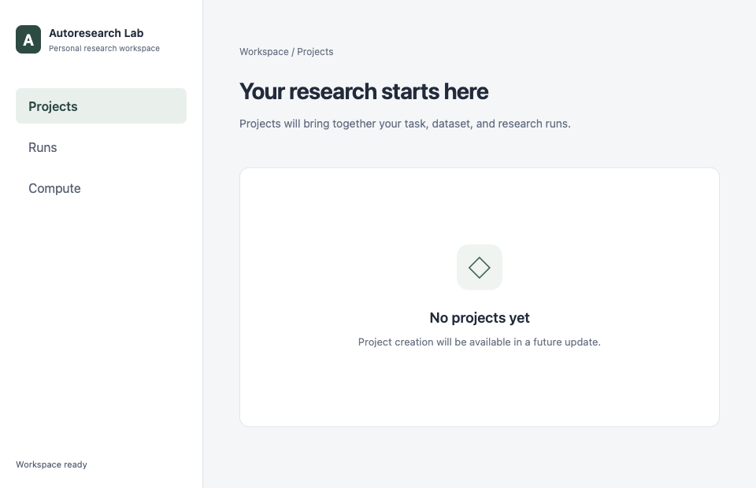
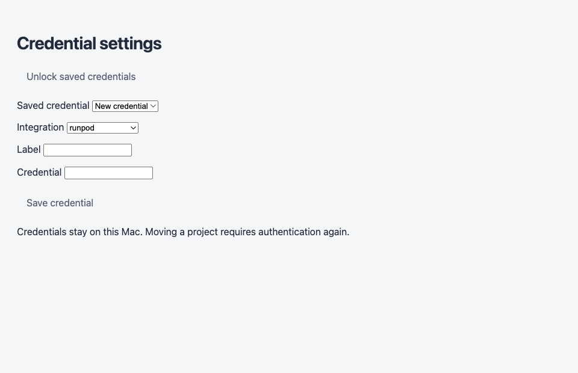
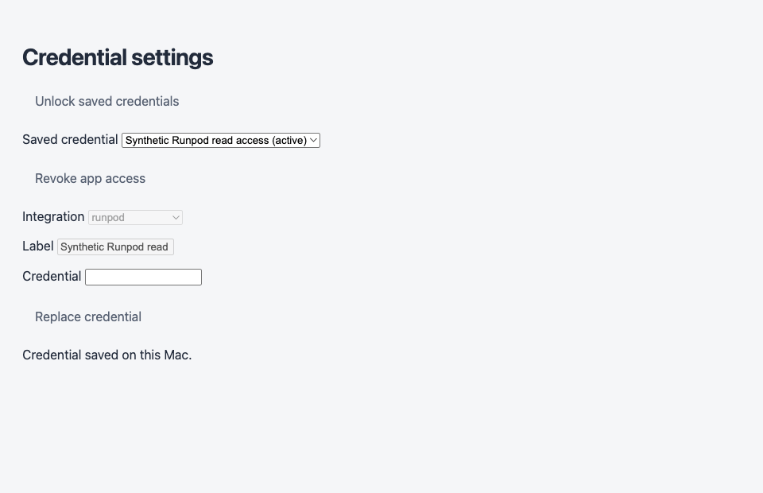

# Issue 21 — before and after UI evidence

These are direct screenshots of real packaged Electron applications, captured on
2026-11-15 with Playwright. Every image uses a 960 × 620 content viewport and CSS
pixel scale. No image was composited, retouched, or reconstructed from source.
Only native window resizing and ordinary form interactions were used.

**Before — original Projects shell:** the app from PR base
`acfdada4d42d06f556dc0b96e6d3e282eadf85ac` has the initial navigation and empty
Projects state. Its native menu has no Credential settings action, verified by
[capture-result.json](./capture-result.json).

**After — dedicated credential entry:** the changed app opens Credential settings
through its native application menu. The new surface has integration selection,
label and credential inputs, and a save action. Both inputs are empty here.

**After — safe saved metadata:** an explicitly synthetic Runpod entry is selected.
The UI displays its label and active status, replacement and app-revocation
controls, and save confirmation. The credential input remains empty; no real
credential was entered or captured.

## Provenance and validation

The base application was downloaded from successful [main CI run
43741488909](https://github.com/igrgin/autoresearch-lab/actions/runs/43741488909),
whose artifact records the exact PR base SHA. The changed application was
downloaded from successful [PR CI run
43745760046](https://github.com/igrgin/autoresearch-lab/actions/runs/43745760046),
whose head is `ee1997e1bf32c2c7bac53de3bf30ad651616a94f`. That PR run checked out
merge commit `3b68859405287d23f58939d27ddc307792f51dc4`, with the base and head as
parents. Its tree `8cc0d1748fcd929fdf5252f00ced2271e5e05820` exactly matches the
head tree; it introduces no different source content.

[provenance.json](./provenance.json) records source run/artifact identities,
GitHub artifact digests, local app-ZIP and app.asar hashes, and privacy conditions.
[capture-result.json](./capture-result.json) records image hashes/dimensions,
native menu labels and empty-input assertions. Each app used a fresh temporary
profile, removed after capture. The root and other T3 worktrees were not used.
Downloaded build artifacts stayed under this worktree's ignored `out/` directory;
no source checkout or branch reset was needed.

The [capture script](./capture.mjs) passed `node --check` and completed against
both CI apps. It verified PNG signatures/dimensions, the base menu's lack of a
credential action, the changed menu/action, synthetic metadata selection, and
empty credential inputs at every screenshot. All three PNGs were visually
inspected for the correct UI and absence of private content. An initial exact
label locator missed the saved selector; it was corrected to its accessible
combobox name and the complete capture reran successfully.

This update changes evidence and its capture script only. The existing 46-test,
build and packaged-smoke results remain in the [implementation record](../21-credentials-and-safe-recording.md).
It adds no claim of live provider/SDK access, remote isolation, native-history
remediation, or signed-update Keychain qualification. No redundant product build
was required for the evidence update.
