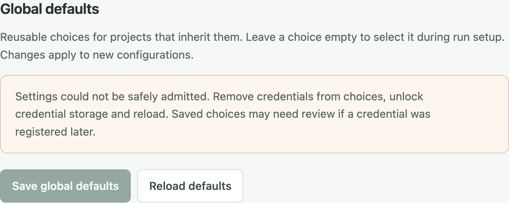
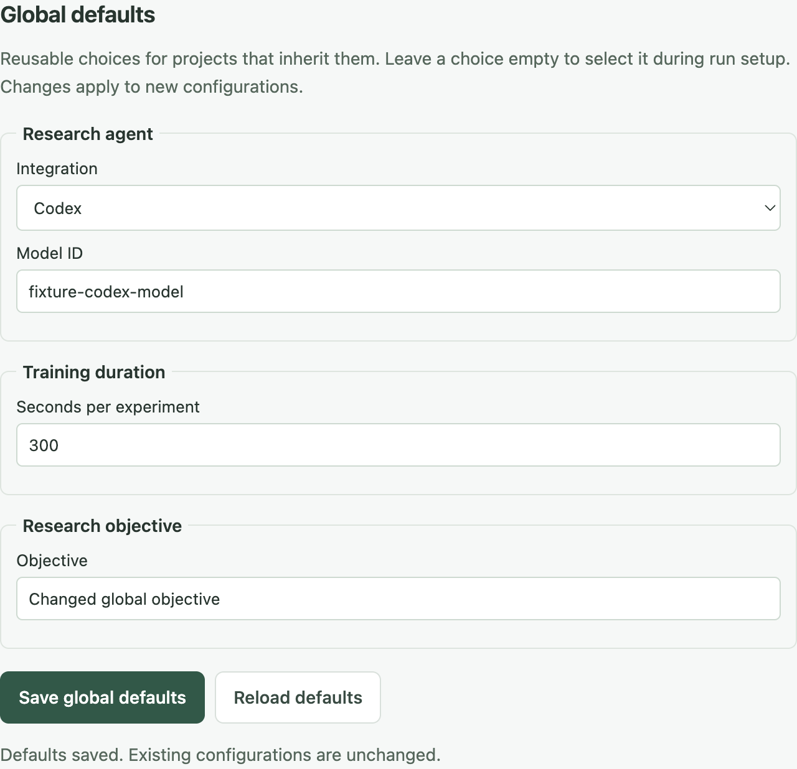

# Defaults recovery

**Before:** the application packaged at stack head
`25175d947209b7d069504152b05687d30c681e94`, after a stored global model became a
recognized synthetic credential and Settings was freshly mounted. The ordinary
read was withheld, and no editor was available to replace it; selecting the
integration timed out.

**After:** the repaired combined package, after explicit replacement of withheld
defaults through a freshly mounted form following a full application restart.
The fixture rotates the synthetic credential before restart. The test repairs
project defaults while global values are still unavailable, then repairs global
defaults. Old saved configuration contents remain unchanged.

These are unmodified region screenshots of the actual packaged Electron UI.
Synthetic credentials and fixture choices are used, with no provider or inference
request. The parent validation receipt correlates the final code and native checks.

