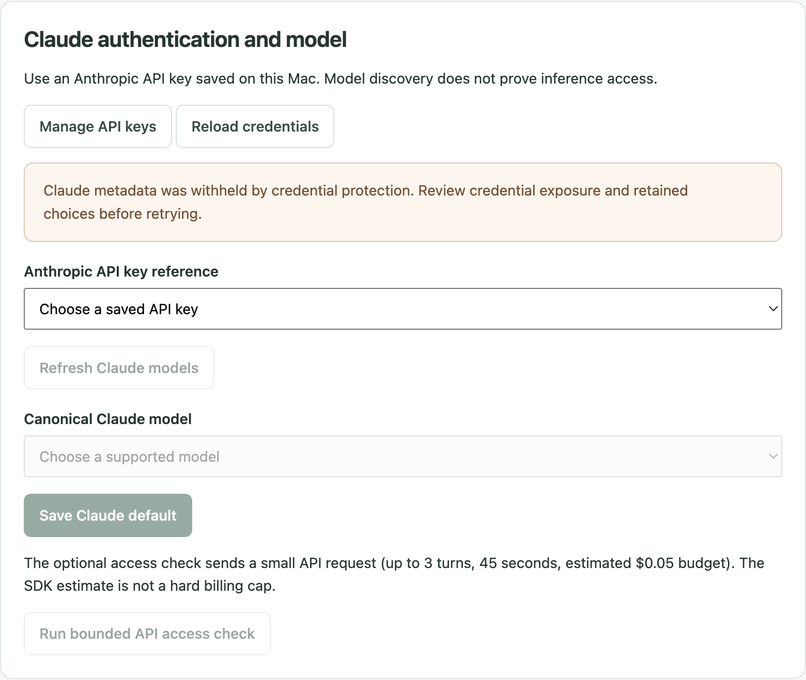
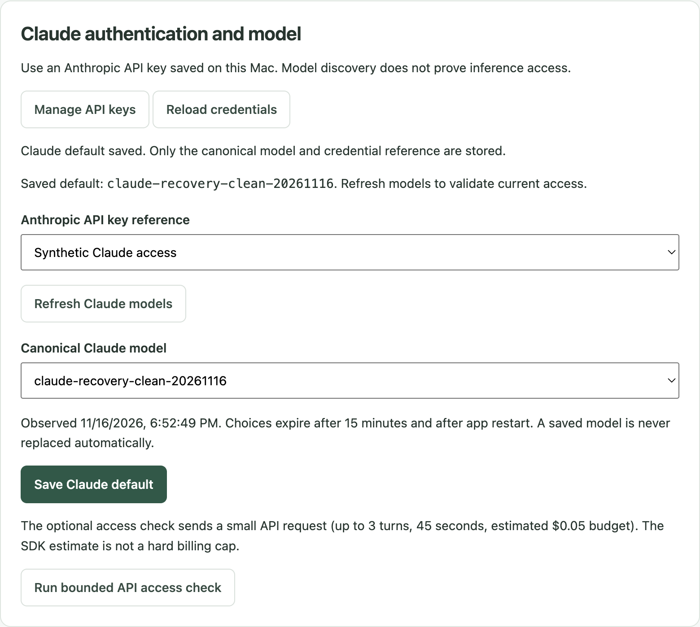

# Claude default recovery

- **Before:** the application packaged at stack head `2d3951292d73c8e1b0d17a15133c72a994cb41ad`, after a synthetic saved model became a recognized credential. The settings panel withheld the old metadata but had no API-key options for a replacement. A UI selection of the original clean key timed out. This reproduction skipped the newer source-only import check, which the older package does not implement.
- **After:** the combined repaired application, after explicit selection of the original clean key and a separate clean fixture model, then saving the next default revision. Strict old-record quarantine remains enforced by unit/restart tests.

Both are unmodified region screenshots from the actual packaged Electron UI.
Discovery uses a controlled worker and synthetic credentials. The images do not
prove live account access or inference. `scripts/smoke-claude-recovery.mjs` drives
the repaired acceptance path; the parent validation receipt records its result.

